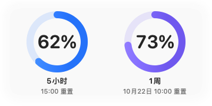
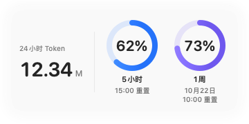

# Codex Usage · macOS 桌面用量卡片

[English](README.en.md) · [下载最新版](https://github.com/WangSH-666/codex-usage-widget/releases/latest) · [MIT License](LICENSE)

一个轻量的原生 Mac 桌面卡片：随时查看 Codex 的 **5 小时 / 1 周剩余额度**，也可以同时查看本机过去 24 小时的 Token 用量。使用 SwiftUI、AppKit 和 Liquid Glass，无第三方运行时依赖。

| 仅剩余额度 | Token ＋ 剩余额度 |
| --- | --- |
|  |  |

截图使用固定演示数据，不包含真实账户记录。

## 下载与使用

1. 在 [Releases](https://github.com/WangSH-666/codex-usage-widget/releases) 下载适合自己 Mac 的 ZIP，解压后把 **Codex Usage.app** 拖入“应用程序”。首个发布包面向 Apple Silicon（M 系列）。
2. 确保已安装并登录 Codex。支持 Codex.app、ChatGPT.app 内附的 Codex 内核或 Codex CLI。
3. 双击打开应用。卡片可以任意拖动；设置通过**卡片右键**或**菜单栏图标**打开。

要求 **macOS 26 或更高版本**。这是独立桌面卡片，不会出现在系统“添加小组件”组件库中。

当前下载包使用 ad-hoc 签名，尚未经过 Apple 公证。如果 macOS 阻止首次打开，请先核对发布页的 SHA-256 校验值，再到“系统设置 → 隐私与安全性”允许打开；也可以[从源码构建](#从源码构建)。

## 功能

- 两种固定尺寸布局：双额度圆环 / Token ＋ 双额度圆环，卡片尺寸 344 × 164 pt。
- 显示剩余百分比和**具体本地重置时间**，无需换算倒计时。
- 浅色、深色、跟随系统，修改后立即生效，系统外观变化时实时跟随；背景不透明度 0–100%，文字和圆环独立保持清晰。
- 六组预设配色：经典蓝紫、薄荷海风、日落珊瑚、森林青苔、莓果暮色、石墨银蓝；也可独立自定义两个圆环。剩余 ≤20% 时显示橙色提醒。
- 位置、配色、布局和设置自动保存；可选置顶、隐藏与恢复，多桌面支持。
- 账户额度每 30 秒更新，失败 10 秒后重试；本机统计可选 10 / 30 / 60 秒刷新。
- 默认停留在桌面层，不遮挡普通或全屏应用；只有手动勾选“始终置顶”才允许悬浮于应用上方。
- 不设置登录自启，也不占用 Dock。退出后从“应用程序”再次打开即可。


## 检查更新

右键卡片或点击菜单栏图标，选择“检查更新…”。应用会显示最新 GitHub 公开版本、更新说明，并提供适配本机芯片的下载入口。下载后退出旧版，用新版替换“应用程序”中的旧应用，再重新打开，原有设置会保留。

仅在手动检查时请求 GitHub 公开发布接口，不发送账户、会话或用量数据。此功能不自动替换正在运行的应用。

## 数据与隐私

- 只读扫描 `CODEX_HOME`（默认 `~/.codex`）中的 `sessions` 和 `archived_sessions`，计算过去 24 小时的累计计数增量，去重重复快照与分叉历史。
- Token 只覆盖本机可见日志，不代表账户所有设备的总量；缓存和推理 Token 不会重复相加。
- 账户额度通过本机已安装 Codex 的 `app-server` 读取，使用当前登录会话。无需 API Key，不调用模型，不读取或保存登录凭据，没有遥测或上传日志功能。
- 未知、过期或窗口不匹配时显示“—”，不推算为 100%；账户读取失败时清空旧额度，避免切换账户后继续展示旧值。
- 应用偏好保存在自己的 UserDefaults 域 `local.codexusage.widget`，不修改 Codex 配置。

日志与账户服务协议可能随 Codex 更新而变化。故障排查见 [使用与构建说明](docs/DEVELOPMENT.md)。

## 从源码构建

需要 Apple Command Line Tools 或 Xcode，**Swift 6.2+、macOS 26+ SDK**，无需第三方 Swift 包：

```sh
git clone https://github.com/WangSH-666/codex-usage-widget.git
cd codex-usage-widget
bash scripts/test.sh
bash scripts/build.sh
open 'dist/Codex Usage.app'
```

也可以双击仓库内的 `Launch.command`：缺少应用时会先构建。生成分享用 ZIP：

```sh
bash scripts/package.sh
```

## 项目结构

```text
Sources/
  CodexUsage/       SwiftUI 卡片、AppKit 窗口、菜单和偏好
  UsageCore/        日志扫描、统计模型、账户 JSON-RPC
Tests/              Swift Testing 回归测试
Resources/          应用 Info.plist
scripts/            测试、构建、图标与发布打包
.github/workflows/  macOS CI 和标签发布流程
docs/               设计、开发说明和演示截图
dist/               本机生成的应用与 ZIP，不纳入 Git
```

[参与贡献](CONTRIBUTING.md) · [架构说明](docs/ARCHITECTURE.md) · [更新记录](CHANGELOG.md)

独立社区项目，与 OpenAI 无隶属关系。代码使用 [MIT 许可](LICENSE)。
